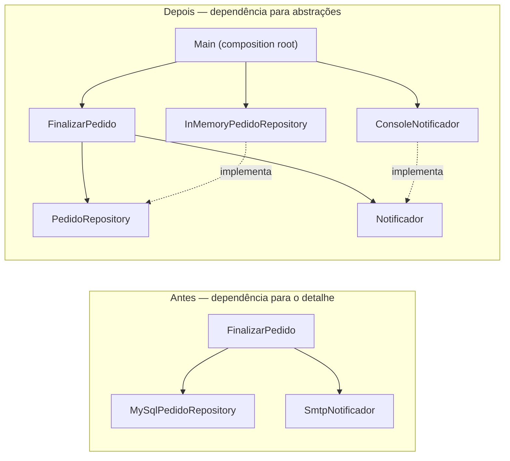

# SOLID #5 — Dependency Inversion Principle (DIP)

Exemplo em Java 17 que compara o mesmo caso de uso de finalização de pedido em
duas arquiteturas:

- `before/`: o caso de uso cria diretamente o repositório e o notificador concretos.
- `after/`: o caso de uso recebe portas definidas pela camada de aplicação; os
  adaptadores são conectados no `Main`, o composition root.

## O princípio

Módulos de alto nível não devem depender de módulos de baixo nível. Ambos devem
depender de abstrações. As abstrações pertencem ao consumidor; os detalhes
implementam essas abstrações.



**DIP** é o princípio de design. **Injeção de dependência** é a técnica usada
para fornecer as implementações ao construtor. **IoC** descreve a transferência
do controle de criação; um contêiner de DI pode ajudar, mas não é necessário:
o `Main` monta o grafo de objetos manualmente.

## Estrutura

```text
before/
  src/main/java/.../before/
    application/FinalizarPedido.java  # instancia detalhes concretos
    domain/                           # Cliente, Item, Pedido
    infra/                            # simulações de MySQL e SMTP
after/
  src/main/java/.../after/
    application/                      # caso de uso e portas
    domain/                           # Cliente, Item, Pedido
    infra/                            # adaptadores substituíveis
    Main.java                         # composition root
  src/test/java/.../FinalizarPedidoTest.java
acceptance-test/
  src/test/java/.../PedidoAcceptanceTest.java
docs/dip.md
```

## Executar

Requer JDK 17 ou superior e Maven:

```powershell
mvn test
```

Esse comando executa os testes unitários do núcleo e os testes de aceitação para
as versões `BEFORE` e `AFTER`. Para compilar todos os módulos:

```powershell
mvn package
```

Para executar o exemplo depois de compilar:

```powershell
java -cp after/target/classes com.example.solid.after.Main
```

Consulte [docs/dip.md](docs/dip.md) para a explicação detalhada das relações,
dos testes e da troca de adaptadores.

> **Nota do exemplo:** os adaptadores com nomes `MySqlPedidoRepository` e
> `SmtpNotificador` em `before` são simulações em memória para que o exemplo e a
> aceitação rodem sem banco ou rede. Eles ilustram o acoplamento às classes
> concretas, mas não implementam protocolos MySQL ou SMTP reais.
