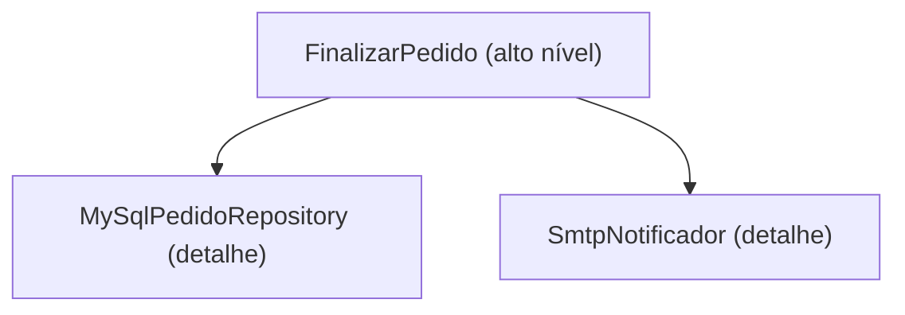
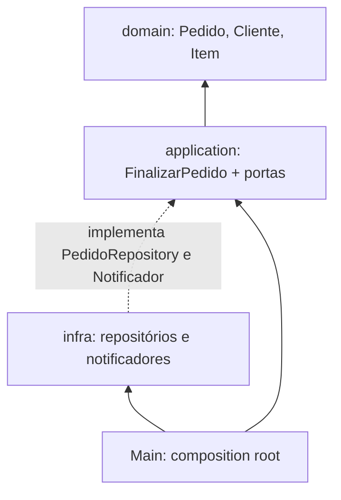

# DIP — Dependency Inversion Principle

Este documento explica as duas versões do caso de uso `FinalizarPedido`, o
sentido das dependências entre camadas e como os testes demonstram o efeito do
princípio.

## 1. A regra do DIP

1. Módulos de alto nível (regras de negócio) não dependem de módulos de baixo
   nível (detalhes técnicos). Ambos dependem de abstrações.
2. As abstrações não dependem dos detalhes; os detalhes é que implementam as
   abstrações.

A interface é definida pelo consumidor. Neste exemplo, o caso de uso precisa
salvar um pedido e notificar o cliente; por isso, `PedidoRepository` e
`Notificador` ficam em `after/.../application`, não em `infra`.

## 2. A versão `before`: o negócio conhece os detalhes

`before/.../application/FinalizarPedido.java` instancia diretamente
`MySqlPedidoRepository` e `SmtpNotificador`:

```java
private final MySqlPedidoRepository repositorio = new MySqlPedidoRepository();
private final SmtpNotificador notificador = new SmtpNotificador();
```

O grafo de dependências aponta do caso de uso para a infraestrutura:



Assim, trocar a persistência ou o canal de notificação exige editar ou substituir
o próprio caso de uso. Também não é possível fornecer uma implementação de teste
sem alterar a classe.

As implementações `MySqlPedidoRepository` e `SmtpNotificador` são **substitutos
em memória**, não clientes reais de banco ou e-mail. Isso mantém a comparação
executável sem configurar serviços externos, sem esconder a dependência direta
do caso de uso às classes concretas.

## 3. A versão `after`: portas no núcleo e adaptadores na borda

As portas expressam somente o que o caso de uso precisa:

```java
public interface PedidoRepository {
    void salvar(Pedido pedido);
}

public interface Notificador {
    void notificar(String destinatario, String mensagem);
}
```

O caso de uso recebe essas dependências obrigatórias pelo construtor:

```java
public FinalizarPedido(PedidoRepository repositorio, Notificador notificador) {
    this.repositorio = Objects.requireNonNull(repositorio);
    this.notificador = Objects.requireNonNull(notificador);
}
```

O sentido das dependências em `after` fica assim:



Regras de importação:

| Camada | Pode conhecer | Não deve conhecer |
|---|---|---|
| `domain` | Tipos e regras do domínio | `application`, `infra` |
| `application` | `domain` e suas próprias portas | `infra` |
| `infra` | Portas de `application` e modelos de `domain` | Detalhes internos do composition root |
| `Main` | `application`, `domain` e implementações de `infra` | — |

O `Main` é a raiz de composição: único ponto que escolhe e conecta as classes
concretas. Não há contêiner, singleton global ou service locator.

## 4. Trocar uma tecnologia sem alterar o caso de uso

`InMemoryPedidoRepository` e `ArquivoPedidoRepository` implementam a mesma
porta. Para escolher o adaptador de arquivo, basta mudar a composição:

```java
PedidoRepository repositorio =
        new ArquivoPedidoRepository(Path.of("pedidos.txt"));
Notificador notificador = new ConsoleNotificador();
FinalizarPedido finalizarPedido = new FinalizarPedido(repositorio, notificador);
```

`FinalizarPedido`, as portas e o domínio não precisam ser modificados. A mesma
substituição pode ser feita por um adaptador JDBC ou um cliente SMTP real sem
que esses detalhes sejam importados pelo núcleo.

## 5. Como os testes demonstram o princípio

### Teste unitário do núcleo

`after/src/test/.../FinalizarPedidoTest.java` fornece lambdas/fakes como
`PedidoRepository` e `Notificador`. O teste comprova a gravação, a mensagem e o
destinatário sem banco, rede ou arquivos. Ele também verifica que dependências
obrigatórias não podem ser omitidas.

### Teste de aceitação compartilhado

`acceptance-test/src/test/.../PedidoAcceptanceTest.java` executa o fluxo
`finalizar pedido → salvar → notificar` nas duas versões. Ambos recebem o mesmo
cenário e devem produzir o mesmo identificador, total, estado de gravação e
destinatário. A versão `after` também verifica a leitura do pedido gravado pelo
adaptador em memória.

O propósito do teste de aceitação é confirmar equivalência do comportamento
visível; o teste unitário do `after` confirma que as portas podem ser
substituídas sem infraestrutura.

## 6. DIP, injeção de dependência e IoC

| Conceito | Papel neste exemplo |
|---|---|
| DIP | Orienta o núcleo a depender de portas estáveis, não dos detalhes |
| Injeção de dependência (DI) | `FinalizarPedido` recebe as portas no construtor |
| Inversão de controle (IoC) | `Main` controla a montagem do grafo; um contêiner seria opcional |
| Portas e adaptadores | Portas no núcleo; implementações concretas na borda |

Receber uma classe concreta pelo construtor é DI, mas não basta para cumprir o
DIP. O consumidor precisa depender de uma abstração adequada, definida no nível
de alto nível.

## 7. Indicadores e checklist

| Indicador | `before` | `after` |
|---|---:|---:|
| Dependências concretas de infraestrutura no caso de uso | 2 | 0 |
| Portas definidas no núcleo | 0 | 2 |
| Banco/rede necessários para os testes unitários do caso de uso | — | 0 |
| Ponto de composição manual | Não separa criação do caso de uso | `Main` |

- [x] As portas pertencem a `application`.
- [x] As dependências são obrigatórias e recebidas pelo construtor.
- [x] `domain` e `application` não importam `infra`.
- [x] O `Main` conecta adaptadores concretos sem framework de DI.
- [x] O núcleo pode ser testado com fakes sem serviços externos.
- [x] A troca de repositório exige somente a seleção de outro adaptador no composition root.
- [x] As portas têm operações coesas com o que o caso de uso consome.

## Referências

- Robert C. Martin, “The Dependency Inversion Principle”, *C++ Report*, 1996.
- Robert C. Martin, *Agile Software Development: Principles, Patterns, and Practices*.
- Alistair Cockburn, “Hexagonal Architecture”.
- Martin Fowler, “Inversion of Control Containers and the Dependency Injection pattern”.
